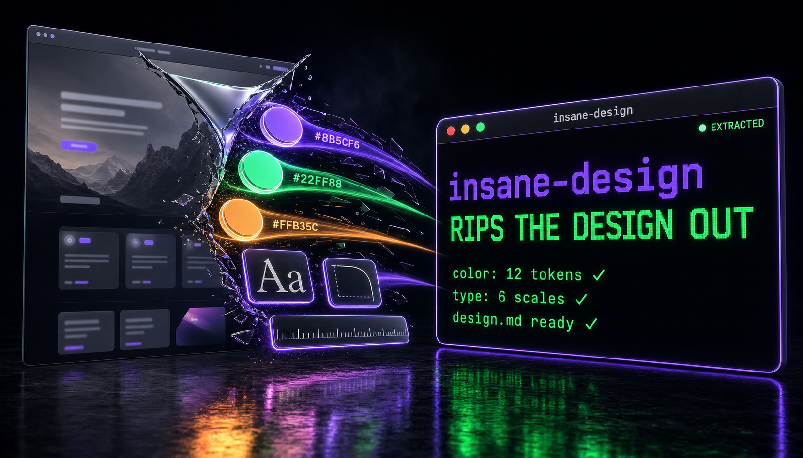

[English](README.md) | [한국어](README.ko.md) | [中文](README.zh.md) | [日本語](README.ja.md) | Español

# insane-design

<div align="center">
  
</div>

> **Arranca el sistema de diseño de cualquier sitio web. En un solo comando.**

"Haz que se sienta como Stripe" no le sirve de nada a la IA — necesita tokens, no sensaciones. insane-design no adivina. Descarga el CSS real, parsea cada custom property, extrae tipografía, espaciado, sombras, radios y degradados, y le entrega a tu agente de IA un `design.md` con el que de verdad puede construir. Además, un informe HTML interactivo con muestras de color de copiar con un clic.

Incluye 100 sitios preanalizados (Stripe, Apple, Linear, Toss, Notion...) — o apúntalo a cualquier URL y listo.

**[Mira la galería — 100 informes de sistemas de diseño →](https://fivetaku.github.io/insane-design/)**

[Inicio rápido](#inicio-rápido) • [¿Por qué insane-design?](#por-qué-insane-design) • [Cómo funciona](#cómo-funciona) • [Funcionalidades](#funcionalidades) • [Requisitos](#requisitos)

---

## Inicio rápido

### 1. Añade el marketplace (una sola vez)

```
/plugin marketplace add https://github.com/fivetaku/gptaku_plugins.git
```

### 2. Instálalo

```
/plugin install insane-design
```

### 3. Reinicia Claude Code

Necesario para que el plugin se cargue.

### 4. Ejecútalo

```
/insane-design https://stripe.com
```

O usa lenguaje natural: "analiza el sistema de diseño de este sitio" — el comando entiende lo que quieres decir.

---

## ¿Por qué insane-design?

- **No es un LLM adivinando** — el CSS se descarga y se parsea directamente. Los valores hex salen de las hojas de estilo reales, no de alucinaciones.
- **Salida lista para IA** — `design.md` está estructurado para agentes de IA. Adjúntalo a cualquier prompt y obtén resultados reproducibles en lugar de sensaciones.
- **100 sitios preanalizados incluidos** — Stripe, Apple, Linear, Vercel, Toss, Nike, Figma, Notion y 92 más. Listos para aplicar sin ejecutar el análisis.
- **Dos modos, un solo comando** — analiza una URL nueva o aplica un sistema de diseño existente a tu proyecto. El mismo comando se encarga de ambos.
- **CSS y config de Tailwind listos para usar** — la salida incluye variables CSS listas para pegar y una extensión de tema de Tailwind. Sin traducción manual.
- **Informe HTML interactivo** — muestras de color con copia al clic, vista previa tipográfica en vivo, barras de espaciado, tarjetas de demostración de sombras — todo lo visual en un solo archivo.
- **Chuleta de inicio rápido** — "Aplica estas tres cosas y ya estás al 80%." Priorizada para lograr el máximo impacto con el mínimo esfuerzo.

---

## Cómo funciona

```
URL
  ↓
Fetch HTML + CSS files (real stylesheet bundles, Chrome UA)
  ↓
Parse CSS custom properties
Extract: color ramps · typography scale · spacing tokens
         radius system · shadow layers · font stack
  ↓
Visual verification via screenshot (Playwright or curl fallback)
Confirm: brand color · light/dark theme · font rendering
  ↓
Generate design.md          Generate report.html
(structured for AI agents)  (interactive browser report)
```

La salida se guarda en `{site-slug}/`:

```
stripe/
├── design.md              # AI agent reference — 16-section structured doc
├── report.ko.html         # interactive HTML report
└── screenshots/
    └── hero-cropped.png   # 1280×800 screenshot
```

---

## Funcionalidades

### Comandos

| Comando | Qué hace |
|---------|----------|
| `/insane-design [URL]` | Analiza un sitio — extrae el sistema de diseño, genera `design.md` + informe HTML |
| `/insane-design [slug]` | Aplica un diseño preanalizado a tu proyecto |
| `/insane-design:analysis [URL]` | Solo modo de análisis |
| `/insane-design:apply [slug]` | Solo modo de aplicación |
| `/insane-design:build [design.md]` | Monta una página/componente nuevo a partir de un `design.md` (o lo sintetiza al vuelo desde una URL) |
| `/insane-design:verify [job_id]` | Consulta el verificador asíncrono — recopila violaciones de los DON'T de la §18 + diff de capturas |

El lenguaje natural también funciona. "Analiza este sitio" activa el modo de análisis; "aplica el estilo de Stripe" activa el modo de aplicación.

### Tokens de diseño extraídos

| Tipo de token | Qué se captura |
|---------------|----------------|
| Colores | Rampa de marca, rampa de neutros, familias de acentos, alias semánticos |
| Tipografía | Escala de títulos/cuerpo — tamaño, peso, line-height, letter-spacing |
| Espaciado | Sistema completo de tokens de espaciado |
| Radios | Escala de border-radius |
| Sombras | Capas de box-shadow (incluidas pilas multicapa) |
| Pila de fuentes | Identificación de fuentes personalizadas + cadena de fallback |

### Estructura de design.md (16 secciones)

| Sección | Contenido |
|---------|-----------|
| 01 Quick Start | Snippet CSS en 3 pasos — "al 80% en 5 minutos" |
| 02 Provenance | URL de origen, fecha de descarga, bytes de CSS |
| 03 Tech Stack | Detección del framework y del namespace del DS |
| 04–05 Typography | Pila de fuentes + escala completa |
| 06 Colors | Rampa de marca · neutros · acentos · capa semántica |
| 07–09 Spacing / Radius / Shadows | Tablas completas de tokens |
| 12 Components | Patrones de clases BEM y variantes de componentes |
| 14 Drop-in CSS | Variables CSS `:root {}` listas para pegar |
| 15 Tailwind Config | Configuración `theme.extend` |
| 16 DO / DON'T | El error más común que evitar en este sitio |

### Modo apply — inyecta los tokens en tu proyecto

El modo apply escanea tu proyecto (globals.css, config de Tailwind o CSS plano) e inyecta los tokens de diseño sin sobrescribir tu configuración existente.

| Objetivo | Qué ocurre |
|----------|------------|
| CSS con `:root {}` | Los tokens se añaden dentro del bloque existente |
| CSS sin `:root {}` | Se crea un nuevo `:root {}` al principio del archivo |
| Config de Tailwind | Se actualizan `theme.extend.colors`, `fontFamily`, `borderRadius` |
| Reaplicación | El bloque `/* insane-design */` se reemplaza limpiamente |

### 100 sitios preanalizados

Stripe, Apple, Linear, Vercel, Notion, Figma, GitHub, Discord, Slack, Spotify, Toss, Baemin, Daangn, Kakao, Naver, Nike, Gucci, Chanel, Tesla, Ferrari, BMW y 79 más. Aplica cualquiera de ellos directamente sin ejecutar el análisis.

---

## Requisitos

### Obligatorio

- [Claude Code](https://docs.anthropic.com/claude-code)
- Python 3.11+
- Pillow (`pip install Pillow`)

### Opcional

- **Playwright MCP** — mejora la calidad de las capturas de pantalla. Sin él, insane-design recurre a una captura basada en curl y sigue funcionando.

---

## Licencia

MIT

---

<div align="center">

**CSS real. No sensaciones.**

</div>
